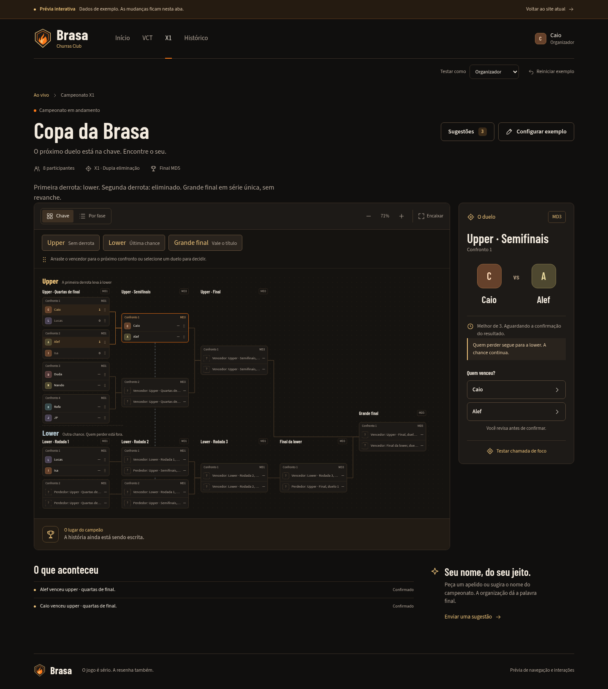
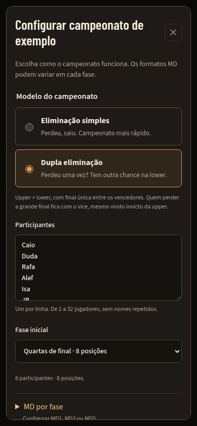

# Prévia X1 da Brasa

A organização atual do site e a home VCT estão em [BRASA-VCT.md](BRASA-VCT.md).

O X1 continua em uma demonstração com dados locais de exemplo:

- `/x1`: apresentação da modalidade secundária.
- `/preview/brasa?tela=x1`: chave interativa.
- `/preview/brasa?tela=sugestoes`: apelidos e títulos com aprovação simulada.

O endereço antigo `/preview/brasa` agora abre a home, cujo foco é VCT.

Em **Configurar exemplo**, o organizador escolhe o modelo:

- **Eliminação simples:** perdeu, saiu; `N - 1` duelos jogados.
- **Dupla eliminação:** a primeira derrota na upper envia o participante à lower;
  uma derrota na lower elimina. Os vencedores das duas chaves disputam uma
  **grande final em série única, sem revanche**, como foi definido para esta prévia.
  Assim, o finalista da upper pode ser vice com apenas uma derrota. São `2N - 2`
  duelos jogados e todos os participantes jogam ao menos duas vezes. Com duas
  posições, há apenas duelo inicial e grande final; nenhuma fase lower fictícia.

O exemplo inicial usa dupla eliminação. A escolha por eliminação simples continua
inteiramente disponível. Trocar modelo, participantes ou capacidade exige confirmar
que a chave e seus resultados locais serão substituídos. Editar apenas um MD ainda
não disputado mantém os resultados e a identidade dos participantes.

É possível configurar MD1, MD3 ou MD5 independentemente por fase da upper, lower e
final, avançar vencedores por botão ou arraste e revisar resultados dependentes antes
de corrigi-los. O perdedor é encaminhado automaticamente; não precisa ser arrastado.
Corrigir um vencedor reabre os resultados dependentes **dos dois caminhos** e pede
confirmação explícita. Resultados independentes e o registro das decisões são mantidos.
Vagas livres avançam automaticamente, sem placar, derrota ou partida fictícia.

No desktop, os atalhos **Upper**, **Lower** e **Grande final** deslocam a chave.
No celular, a visualização **Por fase** abre por padrão e todas as decisões podem
ser feitas com botões. A confirmação explica o destino do vencedor e do perdedor.

O seletor **Testar como** demonstra organizador e participante. Não autentica
nem concede acesso administrativo real. Resultados ficam na memória da aba e
reiniciam ao recarregar ou usar **Reiniciar exemplo**.

Sugestões exigem aprovação dentro do exemplo. Mudar o nome exibido preserva o ID
do participante. Nenhum perfil simulado, sugestão ou resultado é enviado à API.
Os links de navegação saem do exemplo e abrem o site normal, com seus próprios
controles de acesso.

O módulo `brasa-preview` é carregado sob demanda. Marca e ícones compartilhados
ficam em `src/client/ui`. A marca compacta vetorial é uma proposta baseada na
chama, escudo e paleta do logo fornecido; não reproduz o original com os talheres.
As fontes locais incluem suas licenças OFL.

A revisão de dupla eliminação passou por `npm run typecheck`, `npm run build` e
`npm test`: 409 testes em 31 arquivos, incluindo 41 testes de dupla eliminação e
5 de configuração. As simulações cobrem 2 a 32 participantes, chaves esparsas de
32 posições, roteamento sem derrotas fictícias, final única, correções nas duas
chaves e formatos protegidos por dependência.

O Chromium passou por 11 cenários no build final: escolha de modelo, consentimento
para reset, MD independente da lower, teclado e modal nativo, progressão nas duas
chaves, final vencida pelo finalista da lower, correção com reabertura, perfil de
participante, arraste real, 3 jogadores em 32 posições, 2 jogadores, e navegação
em 1440, 390 e 320 px. Não houve erro JavaScript nem chamada à API pelo protótipo.
O roteiro local usou apenas arquivos do build e dados de exemplo; o Supabase
hospedado não recebeu alterações.

X1 ao vivo e sugestões reais por convite continuam nas próximas entregas.
