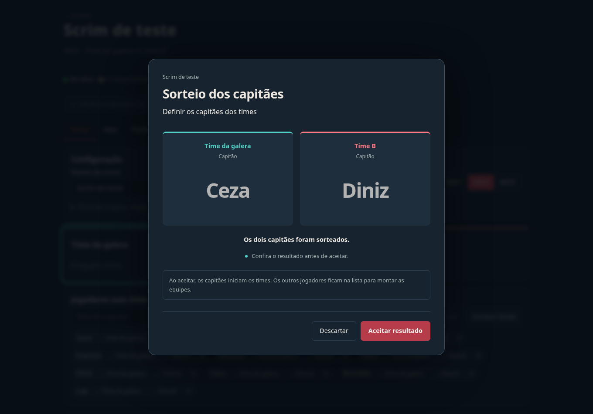
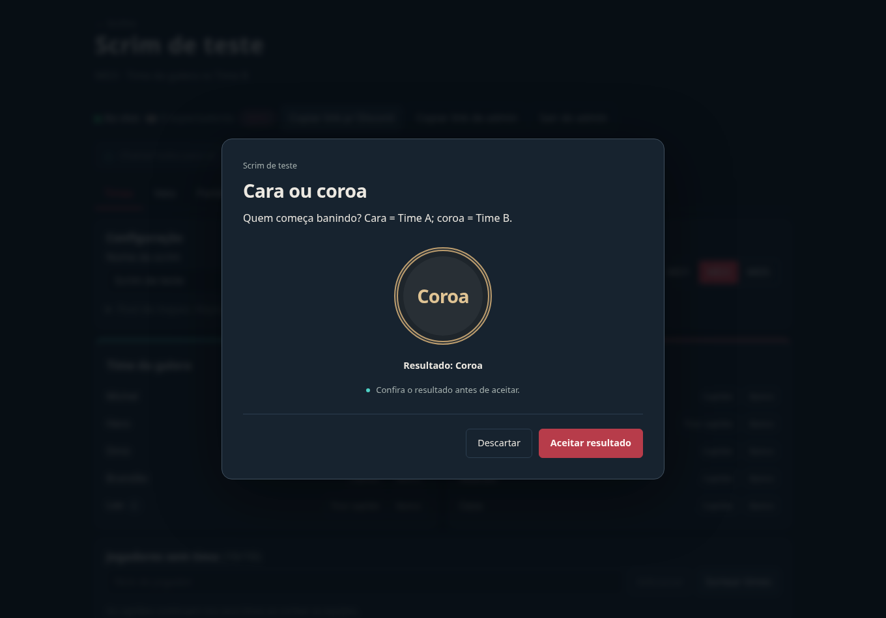

# Atenção do admin e sorteios da sala

Esta feature parte da interface noturna atual de `main`. O redesign do PR #3 continua separado. O plano é acrescentar uma barra pequena antes das abas: **Chamar todos para cá** e **Sorteios**. Não há nova aba nem mudança do fluxo principal da scrim.

## Fluxo

### Chamar todos para cá

O admin abre a aba e o mapa desejados, toca ou edita a seção e aperta **Chamar todos para cá**. Os espectadores conectados à mesma sala abrem essa aba/mapa, rolam até a seção e veem um contorno por cinco segundos. Depois podem navegar livremente.

A chamada transmite apenas identificadores permitidos de aba, mapa e seção. Valores ainda não salvos e credenciais não são transmitidos. Campos que salvam ao perder foco terminam o salvamento antes de enviar a chamada. A mensagem expira em dez segundos para não levar quem reconecta a um ponto antigo. O navegador continua responsável pela aba/janela em primeiro plano: a feature muda a visão dentro da aplicação.

### Capitães da lista geral

1. Durante a preparação, adicione pelo menos dois jogadores à lista da sala.
2. Abra **Sorteios → Capitães**. Confira candidatos e o motivo.
3. **Sortear para todos** abre o palco em todos os navegadores conectados.
4. O servidor escolhe dois jogadores distintos, sem reposição. A roleta apresenta os nomes por quatro segundos.
5. O admin pode **Aceitar resultado** ou **Descartar**. Os espectadores aguardam essa decisão.

Aceitar coloca o primeiro jogador no time A e o segundo no time B, define ambos como capitães e devolve os demais à lista sem time, numa única operação. Esse efeito aparece antes de iniciar e antes de aceitar. Descartar preserva a formação anterior. Se o admin usar **Sortear times** depois de aceitar os capitães, eles ficam nos respectivos times e somente os demais jogadores são embaralhados.

### Cara ou coroa

O admin preenche **O que estamos decidindo?**, por exemplo: “Quem começa banindo? Cara = Tartarugas; coroa = Lebres.” A sala vê o mesmo motivo, animação e resultado. O admin aceita ou descarta. A decisão aceita fica registrada junto ao motivo; o admin aplica a consequência correspondente à partida.

## Pausa, recuperação e histórico

- Há apenas um sorteio pendente por sala. O conteúdo de fundo fica indisponível e a API também bloqueia alterações de jogo até resolver ou expirar.
- Um sorteio sem decisão expira após dois minutos e libera a sala. A expiração nunca aplica o resultado.
- Recarregar ou reconectar recupera o sorteio vigente e seu horário de revelação; a tentativa não é sorteada de novo.
- Uma tentativa descartada permanece no histórico. Sortear outra vez cria uma tentativa nova.
- Linha do tempo e relatório Markdown registram motivo, resultado e decisão. Os nomes sorteados são os do momento da tentativa.
- O modal mantém o foco do teclado, devolve o foco ao encerrar e respeita movimento reduzido. Não há som automático.

## Implementação e ambiente

`POST /api/scrims/:id/tools` recebe foco, início e decisão. O servidor autentica a chave de admin e gera o resultado com `crypto.randomInt`; o cliente não envia vencedores, candidatos ou relógios. Inícios repetidos com o mesmo `requestId` recuperam a mesma tentativa. Eventos internos de sorteio/foco são recusados em `/command`.

Estado e eventos usam a transação e o controle de versão existentes em `append_scrim_event`, transmitidos por Supabase Realtime. Campos novos são opcionais, mantendo snapshots e replays antigos. O sorteio de times preserva capitães somente quando o novo comando pede isso explicitamente; eventos históricos conservam o comportamento anterior.

Não são necessárias novas variáveis, tabelas ou migrações SQL. Para aproveitar o ambiente existente, o foco também vira um evento com expiração. Isso aumenta a versão da sala: uma chamada durante a conferência de importação pode exigir nova revisão antes de confirmar o resultado.

O usuário informou que não existe um tenant separado de desenvolvimento e pediu uso do projeto atual. A entrega é em branch e Preview próprios, sem merge automático. **Para testar em grupo, todos devem abrir o mesmo endereço de Preview e uma sala descartável criada nele.** A versão antiga de produção ainda não conhece a nova interface e suas guardas. Não é necessário abrir nem alterar as scrims existentes. `/preview.html` continua sendo a demonstração antiga e independente.

## Evidências de validação

- `npm ci`, `npm run typecheck`, `npm run build` e `npm test` executados.
- **95 testes passaram em 11 arquivos**, incluindo domínio, API, replay, autorização, CAS, idempotência, componentes, dois clientes Realtime simulados e SQL/RLS existentes em PGlite.
- Chromium: um admin e dois espectadores, incluindo celular e movimento reduzido, usando a API HTTP real com REST Supabase/Phoenix simulados localmente. Cobertura de chamada pontual, mapa específico, salvamento antes do foco, modal global, capitães distintos, descarte, aceitação atômica, times mantendo capitães, moeda com motivo, mesma revelação, recarga durante o sorteio, teclado, foco recente no snapshot inicial, foco expirado e liberação do modal por expiração. Motivo longo conferido em 320 px.
- Capturas usam dados locais de teste. Não houve escrita em Supabase de produção nem uso das salas reais para testes.

A validação local não certifica a entrega Realtime do projeto hospedado. O Preview da Vercel pode exigir login pela proteção do projeto; a validação final em grupo deve usar esse Preview antes de mesclar.
