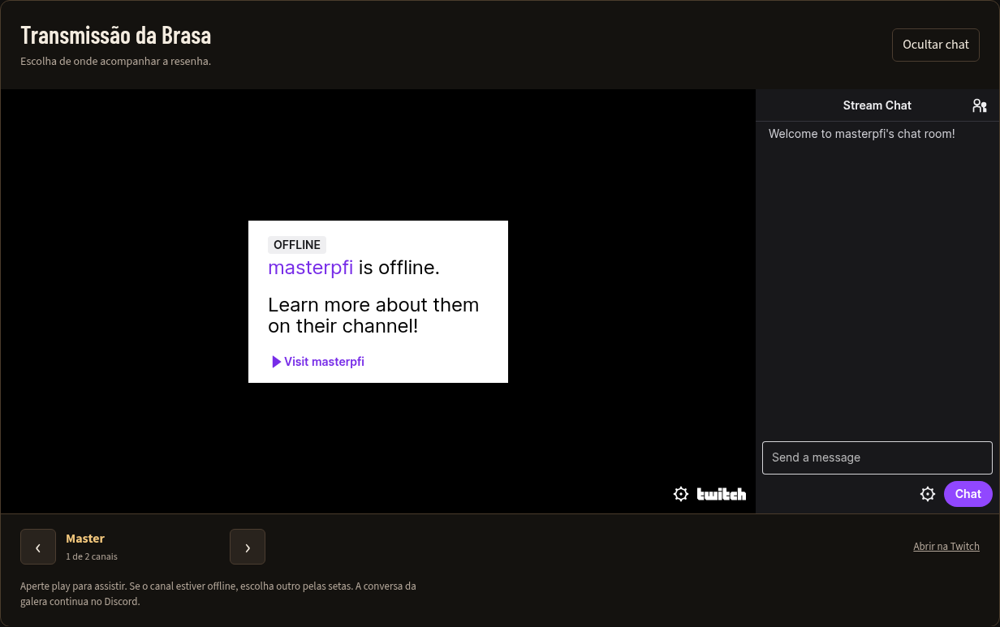
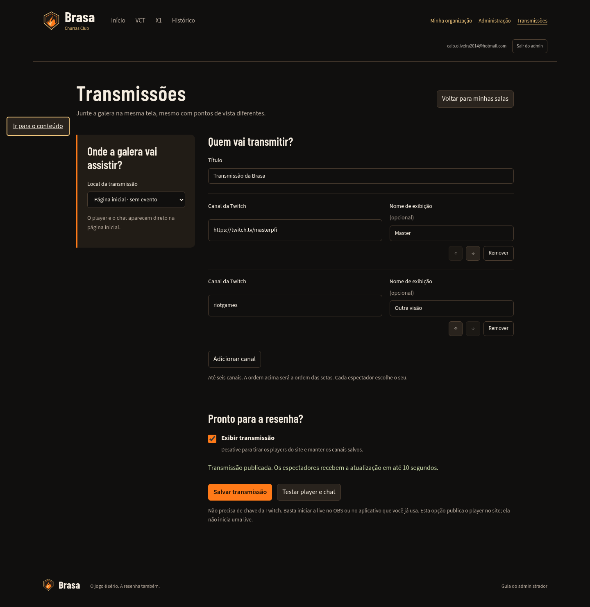

# Validação da entrega Twitch

Ambiente local isolado, com React/API e migrações reais, banco PGlite e provedores
de Auth/REST/Phoenix fictícios. Nenhuma sala ou conta de produção foi criada.

- Suíte completa inicial: **429 testes aprovados** localmente e no CI.
- Build de cliente/servidor aprovado localmente e no CI.
- Fluxo de navegador: login com retorno ao painel de transmissões, prévia sem
  publicação, publicação independente na home, troca de vídeo/chat juntos,
  seleção independente em outro espectador, destaque do evento levando à sala
  e ocultação removendo a transmissão pública.
- Larguras 1440, 390 e 320 px: sem overflow. O iframe do vídeo mantém viewport
  interno mínimo de 400×300 mesmo quando ajustado visualmente no celular.
- Revisão encontrou uma troca involuntária do primeiro canal ao reordenar a
  lista. Corrigida, com regressão cobrindo seleção inicial, remoção e retorno de
  um canal. A suíte passa a ter **430 testes** com esse caso adicional.

## Embed real

Foram carregados os embeds oficiais de `masterpfi`, com `parent=localhost`.
A Twitch exibiu o canal offline e o chat com a mensagem de boas-vindas. Não houve
reprodução audiovisual validada de uma transmissão ativa, nem login/postagem
no chat usando uma conta Twitch real.

O navegador Cloud precisou aceitar o certificado interceptado pelo proxy local
para essa verificação. Esse ajuste é exclusivo do teste; não existe bypass de
TLS no aplicativo. Scripts de terceiros da Twitch também emitiram erros de
acesso ao storage no contexto automatizado; o player e o chat carregaram.
Os testes do código da aplicação e os diagnósticos dos embeds são separados.

## Confirmação no ambiente hospedado

O Preview Vercel foi publicado com os checks aprovados. Usa a proteção de login
da Vercel. Para ativar no banco hospedado é necessário aplicar uma vez
`20261113_streams.sql`; este ambiente não possui acesso de gestão/SQL ao projeto.
Depois disso, cadastrar o canal em `/admin/lives`, publicar e conferir a live
ativa no domínio de produção, incluindo áudio e a conta Twitch no chat.
