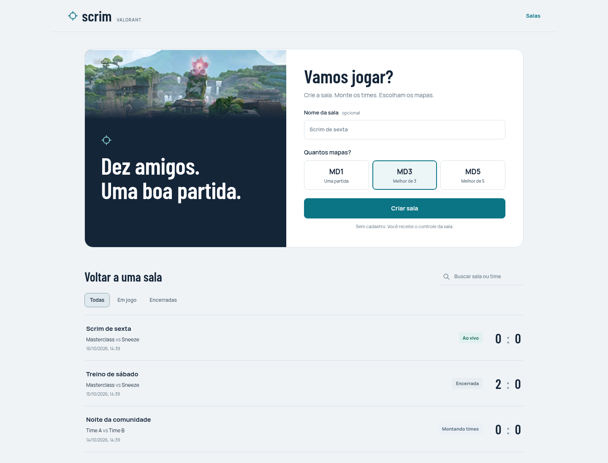
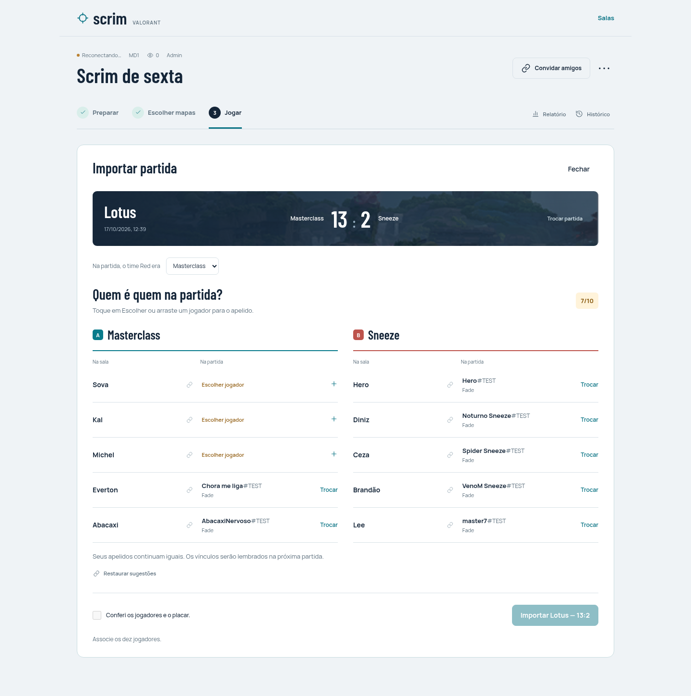

# Lobby da scrim

A interface React foi desenhada para quem usa a sala de vez em quando e quer começar a jogar: três momentos, uma próxima ação clara e configurações secundárias recolhidas. `/preview.html` continua sendo a demonstração estática anterior; estas alterações são na aplicação real.

## Fluxo

- **Criar sala:** formulário imediato, formato MD3 já selecionado e nome opcional. Salas recentes ficam abaixo, com busca e filtros.
- **Preparar:** cinco vagas por time, adição direta ou colagem de uma lista. É possível escolher capitão, mover jogadores, sortear os times e editar formato/pool nas opções. Quando ambos os times estão completos, o avanço para os mapas acompanha a rolagem.
- **Escolher mapas:** uma instrução por turno. A ordem completa e o reinício ficam recolhidos; desfazer continua disponível quando permitido.
- **Jogar:** mapa e placar em destaque. A importação tem prioridade; rounds e K/D/A manuais ficam recolhidos. Relatório e histórico são acessos secundários.
- **Associar:** os dez pares ficam visíveis, com sugestões de nomes e identidades já salvas. Só é preciso usar **Escolher jogador** ou **Trocar** nos pares a corrigir. O mesmo vínculo pode ser feito por clique/toque, teclado ou arrastar em ambos os sentidos. Uma identidade nunca pertence a dois apelidos.
- **Confirmar:** jogadores e resultado são conferidos no mesmo espaço. O checkbox explícito continua obrigatório; mudar vínculo, orientação ou versão da sala exige nova conferência. O botão acompanha a rolagem quando os dez pares estão completos.

A navegação segue a fase da sala. Quem abre uma série encerrada vê o último mapa jogado, sem cair no desempate que não aconteceu. As tabelas rolam internamente em telas pequenas. Foco visível, retorno do foco após ações e redução de movimento são contemplados.

## Direção visual

Base fria clara, azul profundo no placar e petróleo na ação principal. Manrope para leitura e Barlow Condensed para títulos e placares, hospedadas no próprio site com licenças OFL incluídas. O banner local da Lotus tem aproximadamente 63 KB; os mapas continuam usando as miniaturas leves do catálogo existente, com fallback caso o CDN falhe. Não há splash de 5 MB nem novas dependências de runtime.

Capturas com dados de teste e APIs simuladas, sem alterações em scrims de produção:

## Verificação

Executados `npm ci`, `npm run typecheck`, `npm run build` e `npm test`: **56 testes passaram em 8 arquivos**. Os testes de associação cobrem unicidade, time incorreto, remoção, drag nos dois sentidos, revisão obrigatória e sua invalidação, orientação invertida, mapa incorreto, mudança de versão e espectador sem controles.

No Chromium, com APIs simuladas: criar/buscar/filtrar sala; colar dez nomes em dois times; avanço automático para o veto; associação por drag nos dois sentidos e escolha por toque; foco pelo teclado; confirmação explícita; importação preservando apelidos; relatório e ausência de overflow da página em desktop/celular. A associação também foi conferida em 320 e 768 px, além de 390 e 1440 px. Uma cópia dos 59 eventos da scrim existente foi reproduzida localmente, como espectador, confirmando a série 0:2 e o último mapa Bind 6:13. Nenhum teste gravou dados em produção.

Não há alterações de SQL, contratos de API, regras de domínio ou variáveis de ambiente. O Preview usa a configuração existente da Vercel e pode exigir login pela proteção do projeto.

Para avaliar no Preview: crie uma sala descartável, cole dez nomes, confira a escolha dos mapas e importe uma customizada correspondente ao mapa atual. Corrija um vínculo e confirme que o checkbox volta a ficar desmarcado. Só importe um resultado real se quiser adicioná-lo ao histórico dessa sala de teste.
