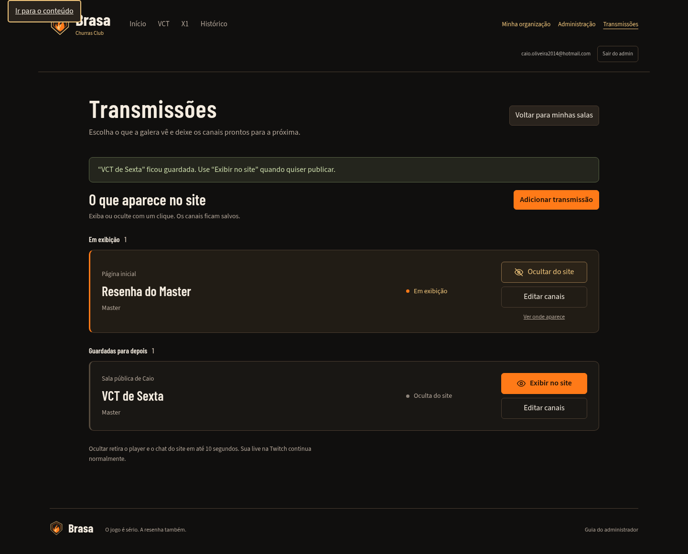
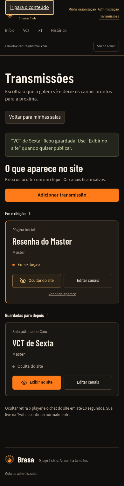

# Controle direto da exibição de transmissões

O checkbox de exibição ficava no fim do editor e exigia outro clique em salvar.
O administrador também não via, de uma vez, quais destinos estavam publicados.

## Decisão de interface

Manter a identidade Brasa: carvão `#100f0e`, ferro `#1d1a17`, brasa `#ff7a18`,
dourado `#f1c67c` e marfim `#f4ece0`; títulos em Barlow Condensed e controles em
Source Sans 3. A hierarquia parte da tarefa: primeiro o estado de exibição,
depois o editor. Nenhum efeito ou animação compete com as ações.

O painel abre em **Em exibição** e **Guardadas para depois**. Cada transmissão
mostra nome, destino, canais e estado salvo. **Ocultar do site** e **Exibir no
site** salvam na hora. **Editar canais** abre o formulário separadamente.
No cadastro, **Salvar e exibir** e **Salvar sem exibir** declaram o resultado.

Ocultar sempre usa os canais persistidos, mesmo com campos incompletos no
editor. Uma falha mantém o último estado confirmado. Conflito atualiza o editor
para evitar associar uma versão nova a um rascunho antigo. O foco acompanha a
ação quando a transmissão muda de grupo. Cada aviso identifica a transmissão.

Reusa permissões, RPCs e versão otimista existentes. Sem alteração de API,
migração, credenciais ou player público. Ocultar no site não encerra a Twitch;
as atualizações para espectadores continuam chegando em até 10 segundos.

## Evidências

- `npm test`: **434 testes aprovados**, incluindo gravação direta da visibilidade,
  edição incompleta, conflito, falha de rede e revogação da permissão de publicar.
- `npm run build`: aprovado, com os typechecks de cliente e servidor.
- Navegador com API/SQL reais e provedores locais: cadastro/exibição, ocultação
  direta, estado persistente após reload, cadastro oculto e edição independente.
- Desktop de 1440 px e celulares de 390/320 px, sem overflow; zero erros JavaScript
  no fluxo. Nenhuma escrita no ambiente hospedado.

